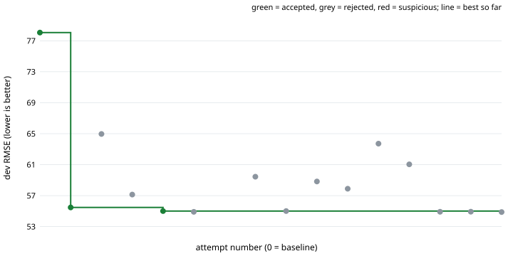

# harness-engineering

A language model on its own is a function from text to text. An **agent harness** is everything around it that turns that
function into something that acts: the loop that keeps calling it, the tools it may invoke, and the guards that decide what those
tools may touch. **The model proposes; the harness disposes.**

This repo explores that from three angles: a harness built from scratch in plain Python, two plugins for an existing harness
(DeepSeek Harness), and an unattended ML experiment loop layered on top of the first.

## What was actually run (read this first)

| part | built | tested | run for real |
|---|---|---|---|
| `harness/` (Part A) | yes | 95 offline tests with a scripted fake model | **no live model**: no API key was available while building. Run `python harness/llm.py` with a free key to check the transport. |
| `dsh-plugins/` (Part B) | 2 plugins | 35 `node --test` tests | **not loaded inside a running DSH**; third-party plugins verified to exist on npm but not installed. |
| `ml-harness/` (Part C) | yes | 38 offline tests | the **random-search proposer ran for real** (numbers below). The LLM proposer has not run against a model. |

Everything below that is a number comes from a run that happened; anything needing a live LLM, a live DSH, or a video is marked `TODO`.

---

## harness/ — built from scratch

[Watch the walkthrough](https://youtube.com/watch?v=TODO) *(to be recorded — see `docs/RECORDING_GUIDE.md`)*

Ten files, `step_01_loop.py` … `step_10_subagents.py`, each runnable on its own, each adding one idea to the last:

1. conversation loop · 2. tool dispatch · 3. errors returned as strings · 4. sandbox fence · 5. human approval re-verified at execution time ·
6. quotas · 7. prefix caching · 8. lazy skills · 9. context compaction · 10. sub-agents

`llm.py` is the only file that does HTTP: any OpenAI-compatible endpoint, **free** OpenRouter `:free` models by default or local Ollama,
with retries, fallback models and empty-reply handling. Details, a demo prompt per step and known limits: [`harness/NOTES.md`](harness/NOTES.md).

```bash
python -m venv .venv && .venv/Scripts/pip install -r requirements.txt
cp .env.example .env            # add a free OpenRouter key, or point LLM_BASE_URL at Ollama
.venv/Scripts/python harness/step_10_subagents.py
.venv/Scripts/python -m pytest -q      # offline, no key needed
```

## dsh-plugins/ — two plugins for DeepSeek Harness

[Watch the walkthrough](https://youtube.com/watch?v=TODO)

- **`second-brain`** — a markdown vault with `[[wikilinks]]` and backlinks: `brain_save/read/search/list` tools plus a system-prompt section.
- **`tool-ledger`** — per-tool call quotas enforced in `tools/pre-execute` (deny by returned decision, refund if another policy denies),
  a redacted JSONL audit trail from `tools/result`, and a `tool_ledger` tool so the model can see its own budget.
- Six community plugins checked with `npm view` and listed in [`installed-plugins.txt`](dsh-plugins/installed-plugins.txt).

Plain ESM JavaScript, logic split from the Cordis wiring so it runs under `node --test` with a fake `ctx`. Design notes, Creator-mode
prompts, the demo script and exactly what is unverified: [`dsh-plugins/NOTES.md`](dsh-plugins/NOTES.md).

```bash
npm test --prefix dsh-plugins     # 35 tests
```

## ml-harness/ — an autoresearch loop on top of harness/

[Watch the walkthrough](https://youtube.com/watch?v=TODO)

An agent proposes a scikit-learn model; a **trusted evaluator** the agent cannot edit decides if it is better. The task is the
diabetes regression dataset, metric RMSE (lower is better), a fixed dev/test split, repeated 5-fold CV on dev only, and the test set
reachable exactly once.

- `evaluate.py` owns the data, split, metric, an AST tripwire and child-process isolation; `lab.py` owns the ledger and accept/reject rules
  (0.5% margin, "too good to be true" results rejected as suspected leaks, duplicates skipped, one look at the test set).
- `proposers.py`: a seeded random search (no LLM) and an LLM agent built on `step_10_subagents.py`, whose only world-changing tool is `run_experiment`.
- `.claude/skills/autoresearch/SKILL.md` lets Claude Code / Codex drive the same loop by hand.

**Result of one real run** (`python ml-harness/run.py run --proposer random --iterations 15 --seed 0`, committed in `ml-harness/runs/random-seed0/`;
re-running reproduced the identical ledger):

| | dev RMSE (CV) | test RMSE (89 held-out rows, seen once) |
|---|---:|---:|
| mean-predictor baseline | 78.06 | 73.22 |
| best candidate (stack: Ridge + SVR + GradientBoosting) | 55.00 | 52.06 |

Honest reading: almost all of the gain comes from "any regularised linear model" (ElasticNet already scored 55.47). The winner beat it by
less than one fold's standard deviation (~3), and four simpler models were statistically tied; one seed, one dataset. LLM-proposer result:
**TODO — needs a free OpenRouter key**. Full table, SVG and caveats: [`ml-harness/NOTES.md`](ml-harness/NOTES.md).



---

## What I learned

1. **Rules in code, not in the prompt.** A prompt is a request; a path check, an `allowed=` set or a quota is a guarantee. The sub-agent's
   tool list is enforced in `run_tool`, not only hidden from the schema, so a hallucinated call to a forbidden tool is denied.
2. **Errors are data.** Turning every tool failure into a `ERROR:`/`DENIED:`/`QUOTA:` string keeps the session alive and lets the model repair its own call.
3. **Approval must bind to the exact thing approved.** Hashing the call and re-checking at execution time closes the gap between "the human said yes" and "this ran".
4. **Quotas have a concurrency bug waiting to happen.** In the DSH plugin `pre-execute` is async, so a check-then-charge lets parallel calls slip under a
   limit. The fix is reserve first, refund if a later policy denies, and there is a test for it.
5. **Separate the proposer from the referee.** The autoresearch loop works because the agent can only submit candidates: it cannot touch the data,
   the metric, the split or the test set, and every attempt (including failures) lands in an append-only ledger.
6. **Optimism hides in the selection step.** After many tries on the same CV folds the best dev score is biased low. Looking at the test set exactly
   once (and enforcing it in code) is what makes the 52.06 trustworthy, and noticing that the "winner" was within noise of simpler models is what
   stopped me over-claiming.
7. **Static checks are tripwires, not sandboxes.** The AST filter catches honest mistakes and lazy cheating; process isolation and a timeout
   handle the rest; a determined attacker with code execution is out of scope, and the notes say so.
8. **Be explicit about what did not run.** Offline tests with a scripted model proved the harness logic, but not that a free model can drive it; the README
   says which is which instead of letting a green test suite imply more.

## Repo map

```
harness/       Part A — llm.py, step_01 … step_10, skills/, sandbox/, NOTES.md
dsh-plugins/   Part B — second-brain/, tool-ledger/, installed-plugins.txt, NOTES.md
ml-harness/    Part C — evaluate.py, lab.py, proposers.py, run.py, program.md, runs/random-seed0/, NOTES.md
tests/         pytest for Parts A and C (offline)
docs/          RECORDING_GUIDE.md — what to say and run in each video
```
