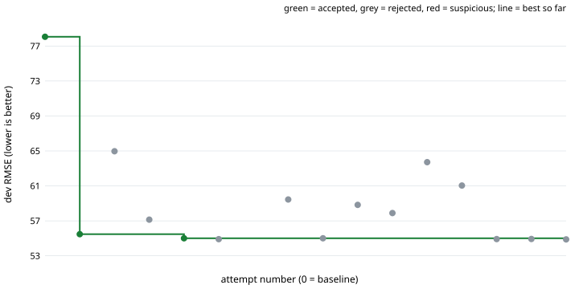

# Results: `random-seed0`

- Task: diabetes regression, RMSE (lower is better). Dev = 80% of rows, test = 20% (locked until `final`).
- Proposer(s): random(seed=0); attempts: 15 (2 accepted, 1 duplicate, 12 rejected)
- Baseline dev RMSE (repeated 5-fold x3 CV): **78.06**
- Best dev RMSE: **55.00** (29.5% below the baseline)
- Held-out TEST RMSE (looked at once): baseline **73.22**, best candidate **52.06** on 89 rows

| iter | status | dev RMSE | std | hypothesis |
|---:|---|---:|---:|---|
| 0 | accepted | 78.06 | 3.81 | mean predictor (no features) |
| 1 | accepted | 55.47 | 3.05 | StandardScaler + ElasticNet(alpha=0.9298, l1_ratio=0.7) |
| 2 | rejected | 64.96 | 3.26 | GradientBoosting(n=100, lr=0.01016, depth=1, subsample=0.7) |
| 3 | rejected | 57.14 | 3.82 | degree-2 polynomial features (interaction_only=False) + Ridge(alpha=86.04) |
| 4 | accepted | 55.00 | 2.97 | stack Ridge(alpha=0.8342) + SVR + GradientBoosting with a Ridge meta-model |
| 5 | rejected | 54.90 | 3.02 | StandardScaler + BayesianRidge |
| 6 | duplicate | - | - | StandardScaler + BayesianRidge _(error: identical source was already scored)_ |
| 7 | rejected | 59.45 | 2.90 | GradientBoosting(n=50, lr=0.03069, depth=2, subsample=0.7) |
| 8 | rejected | 55.00 | 2.99 | stack Ridge(alpha=0.2182) + SVR + GradientBoosting with a Ridge meta-model |
| 9 | rejected | 58.83 | 3.71 | degree-2 polynomial features (interaction_only=True) + Ridge(alpha=3.026) |
| 10 | rejected | 57.89 | 2.79 | RandomForest(n=200, depth=6, leaf=5, max_features=0.3) |
| 11 | rejected | 63.72 | 3.68 | HistGradientBoosting(iter=200, lr=0.05055, depth=None, l2=1.17) |
| 12 | rejected | 61.04 | 3.45 | StandardScaler + SVR(rbf, C=9.989, epsilon=2.459, gamma=0.006672) |
| 13 | rejected | 54.91 | 3.01 | StandardScaler + Lasso(alpha=0.471) |
| 14 | rejected | 54.93 | 3.09 | StandardScaler + Ridge(alpha=0.01513) |
| 15 | rejected | 54.87 | 3.04 | StandardScaler + Ridge(alpha=2.559) |

> The best dev RMSE is the minimum over many tries on the same CV folds, so it is optimistic. The held-out test number is the honest one.
